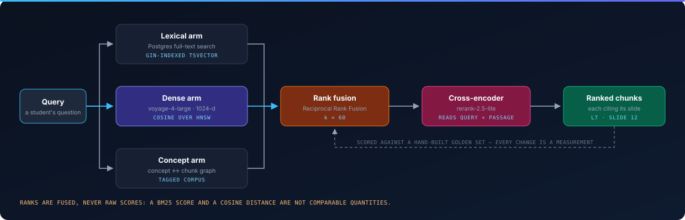
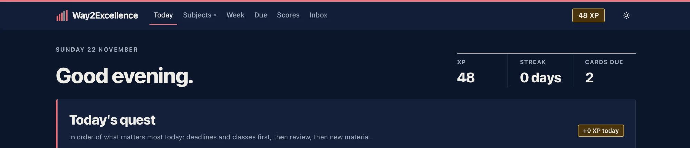

<h1 align="center">Case studies</h1>

  <b>Three systems I built and run — what they do, and the decisions that made them work.</b> 
  The repositories are private. The thinking is not.

<a href="https://github.com/LouisNeubauer">← back to profile</a>

---

# 1 · Study Archive — retrieval that cites the slide

**The problem.** A semester produces a few hundred artefacts across Canvas, an inbox and a laptop. A general-purpose chatbot is worse than useless for revision: it answers confidently from the internet rather than from the professor's actual material.

**The hard part is not the chatbot. It is the retrieval.** A single search strategy fails in a predictable way — keyword search misses a paraphrase, vector search misses an exact token like `15.071`, and neither knows that two slides belong to the same concept.

### The four decisions that matter

**Fuse ranks, not scores.** A BM25 score and a cosine distance are not comparable quantities. Adding them asserts a conversion factor nobody measured, and the weighting then drifts silently as the corpus grows. Reciprocal Rank Fusion only asks *where* each arm placed a chunk — a question both arms can actually answer.

**Put the cross-encoder last.** The embedding model scores query and chunk separately, which is what makes it cheap enough to run over the whole corpus. A cross-encoder reads both together and is far more accurate — and far too slow for the corpus. Running it over ~50 fused candidates buys the accuracy at a cost that stays flat.

**Rerank the same text that was embedded.** The reranker is given the prefixed chunk, because the prefix is in the embedding too. Scoring bare text against a prefixed embedding ranks a different string than the one that was indexed — a silent, permanent quality loss.

**Measure, do not assert.** A hand-built golden set of real questions and their correct answers turns every ranking change from an opinion into a number. Without it, "the search feels better" is all anyone can ever say.

### Two more, briefly

**One scheduler, not two.** The web pages and the Claude tool call the *same* spaced-repetition function. Two schedulers would mean a page and a conversation disagreeing about what is due today — which the user experiences as the system being untrustworthy. The trade-off is written down: cards within a concept come due together.

**Passkeys only.** The archive holds a semester of personal academic material. A reused password is the obvious way to lose it.

`Next.js` · `TypeScript` · `Prisma` · `Neon Postgres` · `pgvector` · `voyage-4-large` · `WebAuthn` · `MCP` · `Cloudflare R2`
~15.6k lines · 30 database models · 40 API routes

---

# 2 · Way2Excellence — a tutor that proves it skipped nothing

**The problem.** Study tools either drill you on what you already picked, or improvise explanations that sound right. Neither tells you what to do at eleven at night.

### The decisions that matter

**Every fact carries its source.** A chip naming the lecture and slide sits on the page — `L7 · slide 12`. Anything the tutor adds beyond the course is labelled **"Beyond your course."** A study tool that quietly invents a definition is worse than none, because the student cannot tell which half to trust.

**Teaching material is written, not generated on demand.** Cards, overviews, diagrams and questions are authored in sessions that can be reviewed before a student sees them. Generating a lesson live is faster to build and impossible to quality-check — and a wrong flashcard gets memorised.

**Quick answers are checked by a second model.** Conversational Q&A runs on a fast model for responsiveness; a separate checker then holds the answer against the source material. Speed where it is safe, verification where it is not.

**The dashboard answers one question.** Not "here is everything" — but *what should I do right now*: deadlines and classes first, then review, then new material.

`JavaScript, no build step` · `Vercel` · `Neon Postgres` · `NVIDIA Nemotron` · `Canvas API`
~25.7k lines · 60 test files · 39 API routes

---

# 3 · The World's Journal — publishing that respects the writer

**The problem.** Long-form writing online is squeezed between social feeds optimised for speed and publishing tools optimised for everyone except the writer.

### The decisions that matter

**One rule that cannot bend.** Nothing goes public that the writer did not publish. Drafts stay private until **Publish**. Nobody edits or deletes anyone else's work. Every post shows who wrote it. Most product rules are preferences; this one is the only promise a writer actually needs.

**Be excellent at two things.** A quiet editor, and an article page that reads like a well-set magazine. The feed and the following graph have to work properly — they do not have to be clever. Scope discipline is the feature.

**Start with one audience.** US graduate students first, and the people around them. A product built for everybody reads as though it was built for nobody — and the register of the whole design follows from knowing who opens it.

`JavaScript, no build step` · `Vercel` · `Neon Postgres`
~19.1k lines · 40 test files

---

  All three run on a template I maintain, where a strict CSP with Trusted Types, parameterised SQL, 
  secret scanning, an AI budget guard and accessibility checks are enforced by hooks, by CI, 
  and again by a live check after every deploy.

<a href="https://github.com/LouisNeubauer">← back to profile</a>

