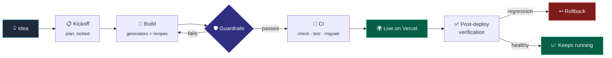

<p align="center">
  
</p>

<p align="center">
  <a href="https://louisneubauer.com"></a>
  
</p>

---

## Hello 👋

I am a **Master of Science in Management Studies candidate at MIT Sloan (2027)**, and I build things that run in production rather than in a slide deck.

My work sits where three lines meet: **machine learning that changes a real decision**, **products that survive past the demo**, and **capital allocation in energy markets**. The projects below are the evidence.

```text
Decisions worth making  →  models that earn their place  →  software that stays up
```

<br>

## 🚀 Flagship work

<table>
<tr>
<td width="50%" valign="top">

### 🍽️ Boston Inspection Risk Ranking
**MIT 15.071 — The AI Edge · Fall 2026**

Boston's Inspectional Services Department runs ~6,000 routine restaurant inspections a year, and 59 % of them fail. No published rule decides which visit comes first. We built one.

A LightGBM model ranked by failure risk puts **88.1 %** of failures inside the first 20 % of visits — against a 59 % baseline and 80.3 % for the strongest hand-written rule. In practice: **~324 more failed inspections caught per year**, found **1.1 weeks sooner**, with the same inspectors and the same budget.

We also measured the fairness cost and recommended deploying **without location features** — equal accuracy, far more even coverage across Dorchester and Roxbury.

`Python` `LightGBM` `XGBoost` `scikit-learn` `MiniLM / transformers`

**→ [Read the full analysis](https://github.com/nh13120/boston-restaurant-inspection-risk)**
<br><sub>Team: Nicolas Hong · Louis Neubauer · Robin Cen · Jose Plaza Carreras</sub>

</td>
<td width="50%" valign="top">

### ⚡ AI, Electricity Demand & Capital
**Master's Thesis · MIT Sloan**

*AI-Driven Electricity Demand and the Allocation of Capital: Bridge Power vs. Clean Energy Investment.*
Advisor: **Prof. Roberto Rigobon**.

Data centres are rewriting the load curve. The question this thesis asks is where the money goes because of it — into gas as a bridge, or into clean generation — and what actually drives that split.

The research workspace is built like an engineering project, not a folder of drafts: a single source-of-truth state document, a **claims ledger** where every assertion is traced to its source, a decisions log, and specialist research agents for literature, data and review.

`Research engineering` `Energy economics` `Reproducible analysis`

<sub>🔒 Private repository — happy to walk through the methodology.</sub>

</td>
</tr>
</table>

<br>

## 🏗️ How I build

Most side projects die at the demo. I got tired of that, so I built the thing that fixes it: **BuildYourMind**, a production template that turns an idea into a deployed, tested, monitored application — and keeps it that way.



**The guardrails are not advice — they are enforced**, by local hooks, by `npm run check`, by CI, and again by a live check after every deploy:

| Guardrail | What it prevents |
|---|---|
| 🔐 Strict CSP + Trusted Types | Injected script ever executing |
| 🗝️ Secrets only as 1Password references | A key reaching the repo, the disk or an agent |
| 💉 Parameterised SQL, always | SQL injection |
| 💸 Daily AI budget + kill switch | A runaway loop becoming a runaway bill |
| 🧪 Machine-checked "Done when" | A feature being called finished when it is not |
| ♿ Accessibility + console-clean checks | Shipping something only the author can use |

<sub>Two deliberate variants: **BuildYourMind** for ideas you mean to keep (moves the date rather than cutting the work) and **hackathon-template** for a deadline (cuts scope, ships the demo path). Same stack, opposite instincts.</sub>

<br>

## 📦 Projects

<table>
<tr><th align="left">Project</th><th align="left">What it is</th><th align="left">Stack</th><th align="left">Status</th></tr>

<tr><td><b>Study Archive</b><br><sub>🔒 private</sub></td>
<td>Every lecture slide, reading, note, problem set and recording from a semester — ingested automatically, indexed by course, week and concept, and answerable by a tutor that <b>cites the exact slide</b>. Retrieval quality is measured against a hand-built golden set, not guessed at.</td>
<td><code>Next.js</code> <code>TypeScript</code> <code>Prisma</code> <code>Neon</code> <code>Claude API</code> <code>WebAuthn</code> <code>R2</code></td>
<td>🟢 Running</td></tr>

<tr><td><b>Private Tutor (V1)</b><br><sub>🔒 private</sub></td>
<td>A study system that teaches each topic from zero and <b>proves it skipped nothing</b>. Every subject is a tree; every fact carries a chip naming its source ("L7 · slide 12"); anything outside the course is labelled as such. Teaching material is authored in reviewable sessions — not improvised at request time — and quick Q&amp;A is checked by a second model.</td>
<td><code>JavaScript</code> <code>Vercel</code> <code>Neon</code> <code>NVIDIA Nemotron</code> <code>Canvas API</code></td>
<td>🟢 Live</td></tr>

<tr><td><b>Way2Excellence V2</b><br><sub>🔒 private</sub></td>
<td>The ground-up rebuild of that tutor — and a deliberate experiment in <b>deciding from evidence instead of taste</b>. Six research memos (learning science, gamification, product teardowns, stack, licensing, multi-tenancy) settle the design questions before a line of code, each claim carrying a source link and an explicit "unverified" section. V1 stays live so the two can be compared.</td>
<td><code>Research-first</code> <code>Learning science</code></td>
<td>🔵 Planning</td></tr>

<tr><td><b>The World's Journal</b><br><sub>🔒 private</sub></td>
<td>A publishing platform where everyone has their own journal: long-form writing and photography, a quiet editor, and an article page that reads like a well-set magazine. Built on one hard rule — <b>nothing goes public that the writer did not publish</b>.</td>
<td><code>JavaScript</code> <code>Vercel</code> <code>Neon</code> <code>Postgres</code></td>
<td>🟡 Building</td></tr>

<tr><td><b>BuildYourMind</b><br><sub>🔒 private</sub></td>
<td>The production template above: deployed skeleton from minute one, enforced guardrails, feature generators, tested recipes (search, accounts, uploads, cron, domains) and a documented agent workflow.</td>
<td><code>Node 22</code> <code>Vercel</code> <code>Neon</code> <code>Playwright</code> <code>GitHub Actions</code></td>
<td>🟢 Maintained</td></tr>

<tr><td><b>hackathon-template</b><br><sub>🔒 private</sub></td>
<td>Same foundation, tuned for a clock: two questions, a 60-second demo script, and a live app in roughly 15–20 minutes.</td>
<td><code>Node 22</code> <code>Vercel</code> <code>Neon</code></td>
<td>🟢 Maintained</td></tr>

</table>

<br>

## 🎓 Where it started — Le Wagon, 2021

Before any of this, there was a nine-week bootcamp and no autocomplete worth the name.

[Le Wagon](https://www.lewagon.com/) is an intensive full-stack programme — roughly 400 hours in nine weeks, 9am to 7pm plus homework — that runs Ruby, object-oriented design, SQL and databases, front-end, Ruby on Rails, and then turns you loose on a real project. ([programme](https://www.lewagon.com/web-development-course) · [weekly structure](https://medium.com/le-wagon/9-weeks-teaching-at-lewagon-new-entrepreneur-coding-school-in-paris-d72a3daae7c7))

**I learned to code there the slow way — reading errors, drawing schemas on paper, pairing daily — and that foundation is the reason I can now direct AI tools instead of being directed by them.** You cannot review what you do not understand.

The repositories below are that apprenticeship, left exactly as it happened:

| Repository | The lesson |
|---|---|
| **The_card** 🏆 <sub>🔒 private</sub> | **Final project.** A full restaurant ordering app: authentication, restaurants → menus → orders → line items, QR-code table ordering, live cart updates. The first time all the pieces had to work together. |
| **Le_Card** <sub>🔒 private</sub> | The first run at that domain model — kept, because the second one was better for having had a first. |
| [rails-watch-list](https://github.com/LouisNeubauer/rails-watch-list) | Many-to-many relationships, modelled properly: lists, movies and the bookmarks between them. |
| [rails-wikinimous](https://github.com/LouisNeubauer/rails-wikinimous) | Full CRUD by hand, one route at a time — before `resources` made it invisible. |
| [rails-task-manager](https://github.com/LouisNeubauer/rails-task-manager) | REST conventions: seven actions, and why they are the seven. |
| [rails-longest-word-game](https://github.com/LouisNeubauer/rails-longest-word-game) | Sessions, form round-trips and talking to an external API. |
| [rails-stupid-coaching](https://github.com/LouisNeubauer/rails-stupid-coaching) | The first controller — request in, response out, nothing hidden. |
| [Sailing-School](https://github.com/LouisNeubauer/Sailing-School) | A landing page built from components, back when every pixel was CSS by hand. |
| [first-website](https://github.com/LouisNeubauer/first-website) | Where it genuinely began: raw HTML and CSS, a profile page, and far too many beers. 🍺 |
| [R_a_R](https://github.com/LouisNeubauer/R_a_R) · [rails-yelp-mvp](https://github.com/LouisNeubauer/rails-yelp-mvp) | Scaffolds from the final sprint, kept honestly as the starting points they are. |

<br>

## 🧰 Toolbox

<p>


</p>
<p>


</p>
<p>


</p>
<p>


</p>

<br>

## 📡 Latest work

<!-- LATEST-WORK:START -->

| Repository | What it is | Last update |
|---|---|---|
| **[LouisNeubauer](https://github.com/LouisNeubauer/LouisNeubauer)** | Profile README <sub>`JavaScript`</sub> | today |
| **[The-AI-Edge---Restaurant-Inspection](https://github.com/LouisNeubauer/The-AI-Edge---Restaurant-Inspection)** | _No description yet._ | 11 days ago |
| **[R_a_R](https://github.com/LouisNeubauer/R_a_R)** | next try <sub>`Ruby`</sub> | 5 years ago |
| **[rails-watch-list](https://github.com/LouisNeubauer/rails-watch-list)** | Challenge 1 12.08.2021 <sub>`Ruby`</sub> | 5 years ago |
| **[rails-yelp-mvp](https://github.com/LouisNeubauer/rails-yelp-mvp)** | Challenge 2 11.08.2021 <sub>`Ruby`</sub> | 5 years ago |

<sub>Rebuilt automatically — last run 2026-11-23.</sub>

<!-- LATEST-WORK:END -->

<sub>This section rebuilds itself from my public activity — see <a href=".github/workflows/latest-work.yml">the workflow</a>.</sub>

<br>

---

<p align="center">
  <b>Open to summer 2027 internships</b> in applied AI, data science and product.<br>
  <sub>Machine learning · Applied AI · Full-stack product · Energy &amp; capital markets</sub>
</p>

<p align="center">
  <a href="https://louisneubauer.com">Website</a> ·
  <a href="https://github.com/LouisNeubauer?tab=repositories">All repositories</a>
</p>
