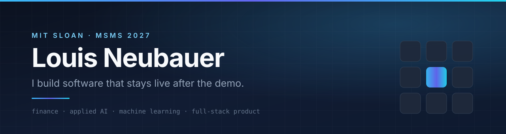
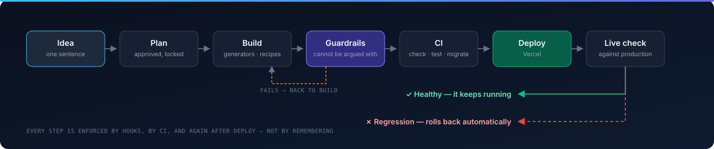
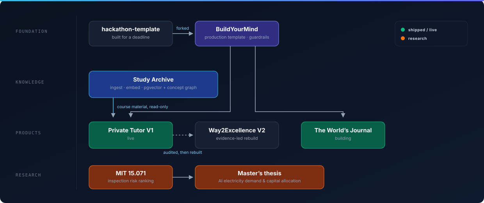

  

  
  
  
  

  <b>Finance is where I am heading. I come at it from the technical side — 
  I would rather build the model and the tool than wait for someone else to.</b>

 

## 🚀 Flagship work

<table>
<tr>
<td width="50%" valign="top">

### 🍽️ Boston Inspection Risk Ranking
**MIT 15.071 — The AI Edge** · Fall 2026

Boston runs ~6,000 restaurant inspections a year. **59 % fail**, and no rule decides which visit comes first. We built one.

|  | Failures caught in the first 20 % of visits |
|---|---|
| No ranking | 59.0 % |
| Best hand-written rule | 80.3 % |
| **LightGBM model** | **88.1 %** |

**→ ~324 more failures caught a year, 1.1 weeks sooner — same inspectors, same budget.**

We also measured the fairness cost and shipped the version **without** location features: equal accuracy, far more even coverage across Dorchester and Roxbury.

`Python` `LightGBM` `XGBoost` `scikit-learn` `MiniLM`

**[Read the full analysis →](https://github.com/nh13120/boston-restaurant-inspection-risk)**
 With Nicolas Hong, Robin Cen and Jose Plaza Carreras

</td>
<td width="50%" valign="top">

### ⚡ AI Demand & Capital Allocation
**Master's thesis** · MIT Sloan · Advisor: Prof. Roberto Rigobon

Data centres are rewriting the load curve. This thesis asks where the money goes because of it — into gas as a bridge, or into clean generation.

**The thesis is mine** — the question, the argument and the writing. What I built around it is the machinery that keeps it honest:

- 📒 **Claims ledger** — no number is used until a primary source confirms it
- 🗳️ **Decisions log** — every decision dated and attributed
- 📝 **Tool-use log** — disclosure already written
- 🔒 **Data rules** — licensed exports never leave MIT OneDrive

**→ By May 2027 every figure should be re-derivable from its source, not remembered.**

🔒 Private — happy to walk through the methodology.

</td>
</tr>
</table>

 

## 🏗️ How I build

Most side projects die at the demo. So I built the thing that fixes it: a production template where the guardrails are enforced by hooks, by CI, and again by a live check after every deploy.

| 🔐 Strict CSP + Trusted Types | 🗝️ Secrets only as vault references | 💉 Parameterised SQL, always |
|---|---|---|
| **💸 Daily AI budget + kill switch** | **🧪 Machine-checked "Done when"** | **♿ Keyboard + screen-reader checks** |

 

## 🗺️ How the pieces fit together

Not a folder of unrelated side projects: one template, one shared knowledge layer, products on top of both.

 

## 📐 Engineering, in numbers

All of it my own code — written, tested and deployed, not scaffolded and abandoned.

| ~87k | ~190 | 90+ | 30 |
|:---:|:---:|:---:|:---:|
| **lines of TypeScript, JavaScript and SQL** | **test files across five live projects** | **API routes in production** | **database models in one schema** |

A test count means nothing on its own, so: <b>security</b> (CSP, Trusted Types, parameterised SQL, secret scanning) · <b>accessibility</b> (keyboard and screen reader, enforced) · <b>real-browser</b> (Chromium via Playwright) · <b>load</b> (concurrency with rate limiting proven to engage) · <b>budget</b> (the AI kill switch actually stops a runaway loop) · <b>database</b> (real Postgres, not a mock that agrees with me).

 

## 🧠 Machine learning, specifically

Not "uses AI" — here is what is actually running.

| System | The neural network | Kept honest by |
|---|---|---|
| **Retrieval** | `voyage-4-large` embeds every chunk into **1024-d vectors** in **pgvector**, cosine over an **HNSW index**; a **cross-encoder** reranks the shortlist | Dense, lexical and concept arms fused by **Reciprocal Rank Fusion** — ranks, never incomparable scores. Every change scored against a golden set. |
| **Tutoring** | A large model answers; a **separate, smaller model verifies** it against the source before it is shown | Teaching material is authored in reviewable sessions, never improvised at request time |
| **Risk ranking** | Gradient-boosted trees, plus a **fine-tuned MiniLM** over inspector comments | Settings frozen before the test years. The transformer gained **one point — and was not shipped.** |

> **The pattern:** reach for the heavier model only when the measurement says it earns its place — and say so out loud when it does not.

 

## 📦 Projects

The repositories are private — <b><a href="CASE-STUDIES.md">the case studies</a></b> show the screens and the decisions behind three of them.

| Project | What it is | Stack | |
|---|---|---|---|
| **Study Archive** 🔒 | A semester of course material, embedded into pgvector and answerable by a tutor that **cites the exact slide** | `Next.js` `TypeScript` `Prisma` `pgvector` `MCP` | 🟢 Running |
| **Way2Excellence V1** 🔒 | Teaches every topic from zero and **proves it skipped nothing** — each fact chipped with its source | `JavaScript` `Vercel` `Neon` `Nemotron` | 🟢 Live |
| **[The World's Journal](https://the-worlds-journal-v1.vercel.app)** 🔗 | Long-form publishing, built on one hard rule: **nothing goes public that the writer did not publish** | `JavaScript` `Vercel` `Postgres` | 🟢 Live |
| **Way2Excellence V2** 🔒 | The tutor rebuilt from the evidence up — six sourced research memos settle the design before any code | `Research-first` | 🔵 Planning |
| **BuildYourMind** 🔒 | The production template above: deployed skeleton from minute one, guardrails CI enforces | `Node 22` `Vercel` `Playwright` | 🟢 Maintained |
| **hackathon-template** 🔒 | Same foundation, tuned for a clock: idea to live app in 15–20 minutes | `Node 22` `Vercel` `Neon` | 🟢 Maintained |

 

## 🎓 Where it started — Le Wagon, 2021

Nine weeks, full time, nine in the morning until seven at night. **I learned to code the slow way — before AI could write any of it — and that is why I can review what it writes now.**

<table>
<tr>
<td width="60%" valign="top">

### 🏆 [The_card](https://github.com/LouisNeubauer/The_card) — final project
A QR-code restaurant ordering app: accounts, menus, live orders, line items.

**266 commits · 121 reviewed pull requests · 5 developers · 23 days** — 75 of those commits mine.

Branch-and-review from day one, nine weeks into learning to code. That is the part worth noticing.

`Rails` `PostgreSQL` `Redis` `Devise` `rqrcode`

</td>
<td width="40%" valign="top">

### The apprenticeship

- [`rails-watch-list`](https://github.com/LouisNeubauer/rails-watch-list) — many-to-many, modelled properly
- [`rails-wikinimous`](https://github.com/LouisNeubauer/rails-wikinimous) — full CRUD, one route at a time
- [`rails-task-manager`](https://github.com/LouisNeubauer/rails-task-manager) — the seven REST actions, by hand
- [`rails-longest-word-game`](https://github.com/LouisNeubauer/rails-longest-word-game) — sessions and an external API
- [`rails-stupid-coaching`](https://github.com/LouisNeubauer/rails-stupid-coaching) — the first controller
- [`Sailing-School`](https://github.com/LouisNeubauer/Sailing-School) — a landing page, every pixel by hand
- [`first-website`](https://github.com/LouisNeubauer/first-website) — where it genuinely began 🍺

Also [`Le_Card`](https://github.com/LouisNeubauer/Le_Card) and [`R_a_R`](https://github.com/LouisNeubauer/R_a_R) — kept honestly as the drafts they are.

</td>
</tr>
</table>

 

## 🧰 Toolbox

 

## 📡 Latest work

<!-- LATEST-WORK:START -->

| Repository | What it is | Last update |
|---|---|---|
| **[The-AI-Edge---Restaurant-Inspection](https://github.com/LouisNeubauer/The-AI-Edge---Restaurant-Inspection)** | MIT 15.071 "The AI Edge" — ranking Boston's 6,000 yearly restaurant inspections by risk of failing. Full analysis in nh13120/boston-restaurant-inspection-risk. | today |

Rebuilt automatically — last run 2026-11-23.

<!-- LATEST-WORK:END -->

This section rebuilds itself from my public activity — see <a href=".github/workflows/latest-work.yml">the workflow</a>.

---

  <b>Open to summer 2027 internships</b> in finance, applied AI and data-driven product. 
  <a href="CASE-STUDIES.md">Case studies</a> · <a href="https://the-worlds-journal-v1.vercel.app">Live demo</a> · <a href="https://www.linkedin.com/in/louis-neubauer/">LinkedIn</a> · <a href="https://github.com/LouisNeubauer?tab=repositories">All repositories</a>

